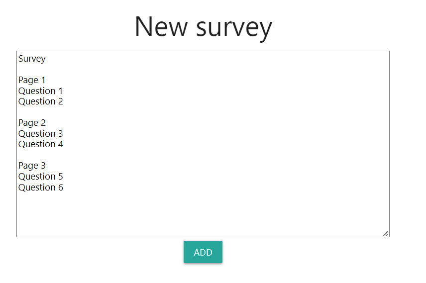
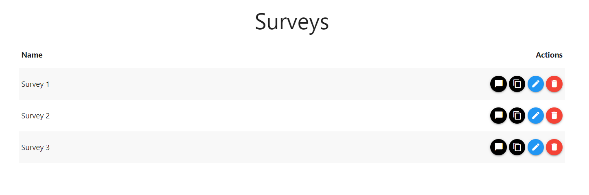
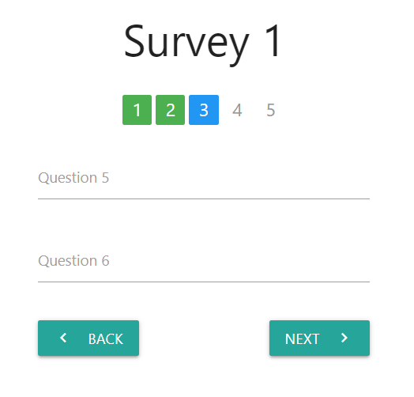
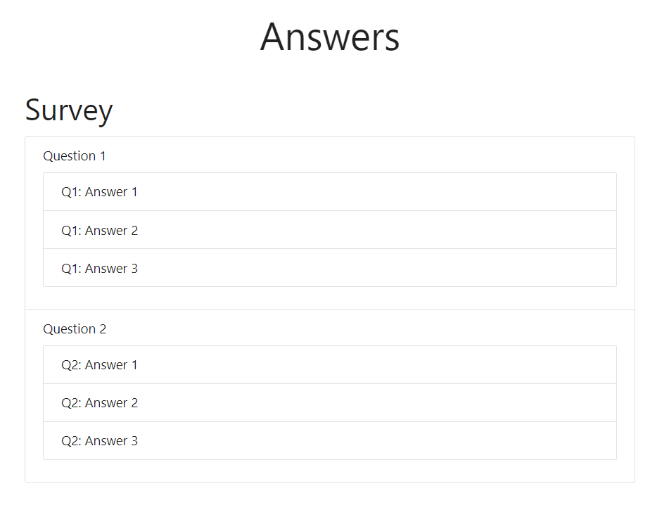

# Опросники

_2-е домашнее задание по курсу «Клиентское веб-программирование»_

## Декларация о самостоятельности выполнения

Пожалуйста, заполните своими данными перед отправкой!

```txt
Boda Bálint
KDHPNI
Клиентское веб-программирование - домашнее задание
Это решение было отправлено и подготовлено вышеуказанным студентом для оценки по курсу «Клиентское веб-программирование».
Заявляю, что это решение является моей собственной работой. Я не копировал и не использовал решения из сторонних источников. Я не передавал решение своим однокурсникам и не публиковал его.
Свод правил для студентов Университета им. Лоранда Этвёша (ELTE Hallgatói Követelményrendszere, Организационный и операционный регламент ELTE, Том II, § 74/C) гласит, что до тех пор, пока студент представляет работу другого студента — или, по крайней мере, значительную её часть — как свою собственную, это считается дисциплинарным проступком.
Самым строгим последствием дисциплинарного проступка является отчисление студента из университета.
```

## Задача

В рамках домашнего задания вам необходимо написать веб-приложение, в котором пользователь может создавать многошаговые опросы. Созданные опросы можно просматривать в таблице, где есть возможность их изменять, удалять, а также делиться ими по ссылке. По этой ссылке затем можно заполнить опрос. Ответы на опросы можно будет просмотреть на отдельной странице.

Задачу необходимо решить с использованием интеграции *React* и *Redux* (для Redux рекомендуется использовать *redux toolkit* и даже *RTK Query*). Поскольку приложение состоит из нескольких страниц, рекомендуется использовать *react-router*.
Серверный REST API для задачи предоставлен, его описание вы можете найти ниже, клиент должен быть адаптирован под него.

## Страницы

### Навигация

В верхней части каждой страницы отображается панель навигации, где название приложения и доступные функции представлены в виде пунктов меню:

- Опросы (это название приложения, клик по нему ведет на главную страницу)
- Если пользователь не авторизован:
  - Регистрация
  - Вход
- Если авторизован:
  - Мои опросы
  - Ответы
  - Профиль
  - Выход

### Главная страница

Страница со статической информацией, содержащая название приложения и краткое описание.

### Регистрация

Необходимо указать следующие данные:

- полное имя (обязательно)
- адрес электронной почты (email, обязательно)
- пароль (обязательно)

Для валидации достаточно стандартных атрибутов HTML5!

### Вход

Выполняется по следующим обязательным данным:

- email (email, обязательно)
- пароль (обязательно)

Для валидации достаточно стандартных атрибутов HTML5!

### Новый опрос

Доступно только после входа в систему.
Содержит одну `textarea`, через которую можно создать новый опрос.
Опрос создается в виде «кода» по следующим правилам:

- первая строка содержит название опроса
- каждая страница внутри опроса начинается с пустой строки
- первая строка страницы содержит её название, а под ней на отдельных строках располагаются вопросы

Введенные данные необходимо валидировать. При проверке формата достаточно контролировать следующее:
- поле не пустое,
- у опроса есть название,
- есть хотя бы 1 страница,
- на каждой странице есть хотя бы 1 вопрос.

Вопросы в любом случае предполагают простой текстовый ответ.

При сохранении опроса REST API автоматически связывает его с вошедшим в систему пользователем и генерирует уникальный идентификатор (`hash`), который затем будет использоваться для ссылки на опрос.



### Мои опросы

Доступно только после входа в систему.
Здесь отображаются опросы, принадлежащие вошедшему в систему пользователю, с их названиями, датами создания и функциональными кнопками. Названия являются ссылками, ведущими на страницу опроса по его хэшу (`hash`), через которую опрос можно заполнить. Для каждого опроса доступны следующие действия:

- его удаление,
- изменение (в интерфейсе «Новый опрос» отображается текущий «код» опроса),
- копирование ссылки в буфер обмена,
- а также просмотр ответов на него.



### Опрос

Зная упомянутую в предыдущем разделе ссылку, любой желающий может получить к нему доступ. Например, `http://localhost:3000/survey/<hash>`.

Опрос отображает вопросы на каждой странице в виде пошаговых этапов. Перейти на следующую страницу можно только в том случае, если пользователь уже заполнил все поля на текущей странице. Навигация осуществляется с помощью кнопок «Вперед/Назад» или кликом по названиям страниц. Перейти на страницу можно только в том случае, если она уже заполнилась или является текущей.

В самом конце при нажатии на кнопку отправки ответы отправляются на сервер. Опрос можно отправить только в том случае, если заполнены все данные.



### Ответы

Доступно только после входа в систему.
Здесь в виде списка отображаются ответы на опрос, выбранный на странице «Мои опросы». Выводится название опроса, вопросы, а под ними — ответы, данные респондентами.



### Profil

Доступно только после входа в систему.
Отображаются данные вошедшего в систему пользователя.

- Имя
- Email
- Количество опросов
- Кнопка выхода

## Клиент

Клиентское приложение должно быть создано в папке `client`. На данный момент папка содержит совершенно чистую установку Vite, необходимые дополнительные зависимости вам нужно добавить самостоятельно. Все ненужные файлы вы можете удалить!

```
cd client
npm install
npm run dev
```

## REST API

Исходный код сервера находится в папке `rest-api`. Его необходимо установить и запустить локально:

```
cd rest-api
npm install
npm start
```

Предоставляются три сервиса:

- `users`
- `surveys`
- `results`

Самый простой способ изучить и протестировать эндпоинты — импортировать следующие коллекции Postman в REST API клиент Postman. Поскольку это веб-приложение, вам необходимо установить Postman Agent локально, затем создать новый Workspace в открывшемся приложении, нажать сверху «Import» и вставить ссылки по одной:

- [коллекция auth](https://api.postman.com/collections/15151253-4cf57ab5-49d7-4350-af18-9e3c7b29626a?access_key=PMAT-01H0JMHKRYB30J9BFQAMQ2PDR2)
- [коллекция surveys](https://api.postman.com/collections/15151253-faa17ed9-b3d4-4e85-b681-52fe8dbfde37?access_key=PMAT-01H0JMK0RGT8BH9CQY6CGF8ZW6)
- [коллекция results](https://api.postman.com/collections/15151253-b3e753b2-42d0-4946-b312-999bb75002d4?access_key=PMAT-01H0JMKX3741T69NKZXD9ABX6Z)

После этого эндпоинты можно тестировать. Отправляемые данные уже подготовлены на вкладке Body.

Для доступа к эндпоинтам `surveys` и `results` требуется авторизация. Для этого необходимо отправить HTTP-заголовок `Authorization` с типом `Bearer token`. Токен возвращается эндпоинтом входа (login). JWT-токен авторизации сохранен на вкладке `Authorization` коллекций `surveys` и `results`, при необходимости его можно там заменить. Указанный там токен также можно использовать для теста, но в приложении его нужно генерировать динамически.

## База данных

Сохраненные данные записываются в локальную таблицу SQLite: `rest-api.sqlite`. Её можно посмотреть и отредактировать, например, с помощью программы [DB Browser for SQLite](https://sqlitebrowser.org/).

## Дополнительная информация

Ожидается аккуратный и эстетичный внешний вид. Для этого вы можете использовать как собственный CSS, так и библиотеки компонентов, например, [Material UI](https://mui.com/) или [Bootstrap](https://react-bootstrap.github.io/).

## Что загружать

Заархивируйте весь проект (и клиент, и сервер) и загрузите архив. **Перед отправкой (архивированием) обязательно удалите папки `node_modules`!**

## Оценка

Всего можно набрать 30 баллов.

- [x] Использование React (обязательно)
- [x] Использование Redux (обязательно)
- [x] Навигация корректно меняется в зависимости от авторизации (1 балл)
- [x] Главная страница отображается (1 балл)
- [x] Регистрация работает (1 балл)
- [x] Вход работает (1 балл)
- [x] Новый опрос, Мои опросы: доступны только после авторизации (1 балл)
- [x] Новый опрос: корректное сохранение нового опроса (2 балла)
- [x] Мои опросы: отображение опросов с доступными функциями (2 балла)
- [ ] Мои опросы: корректная работа изменения (2 балла)
- [x] Мои опросы: корректная работа удаления (2 балла)
- [x] Мои опросы: корректная работа ссылки (1 балл)
- [x] Опрос: вопросы опроса отображаются (3 балла)
- [x] Опрос: вопросы отображаются по страницам с названиями страниц, навигация между страницами корректна (2 балла)
- [x] Опрос: переход дальше возможен только при заполненной текущей странице (1 балл)
- [x] Опрос: на пагинаторе визуально видно, на какой странице мы находимся (1 балл)
- [x] Опрос: корректная отправка ответов (2 балла)
- [x] Ответы: отображаются ответы на выбранный опрос (2 балла)
- [x] Профиль: доступен только после входа, с корректным содержимым (2 балла)
- [x] Профиль: кнопка выхода работает (1 балл)
- [x] Эстетичный внешний вид (2 балла)
- [ ] Дополнительно: постраничный вывод списка моих опросов (например, по 5 штук) (+2 балла)
- [ ] Дополнительно: постраничный вывод списка ответов (например, по 10 штук) (+2 балла)
- [x] Дополнительно: ссылка на опрос копируется в буфер обмена по клику на кнопку (+1 балл)
- [ ] Опоздание на 1 неделю (-3 балла)
- [ ] Опоздание на 2 недели (-6 баллов)
