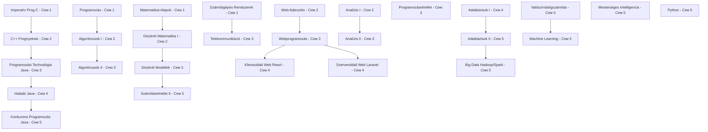

# 🗺️ Навигатор по обучению ELTE IK BSc (Programtervező Informatikus)

Добро пожаловать в ваше личное пространство знаний! Этот файл — центральный дашборд (**Map of Content / MOC**) по всей программе бакалавриата «Программная инженерия» на факультете информатики **ELTE IK** (Будапешт, Венгрия). 

Все материалы, лабораторные работы, домашние задания и экзамены переведены на русский язык и адаптированы под использование в **Obsidian**.

> [!TIP] **Настройка Obsidian для этого репозитория**
> 1. Откройте папку `elte-ik-bsc` как новое хранилище (Vault) в Obsidian.
> 2. Чтобы граф связей и поиск работали быстро и не захламлялись кодом, добавьте служебные папки в исключения:
>    *Перейдите в Настройки -> Файлы и ссылки -> Исключенные файлы* и введите:
>    `**/node_modules`, `**/.git`, `**/.idea`, `**/.vscode`, `**/project/bin`, `**/project/obj`, `**/*.exe`, `**/*.sqlite`

> [!IMPORTANT] **Подготовка перед началом учебы**
> Если вы только начинаете обучение, обязательно ознакомьтесь с **[[Prep_Plan|🚀 Планом домашней самоподготовки перед семестром]]**. Это поможет вам освоить Git, Linux и основы C/Haskell до начала лекций и избежать завалов на сессии!

---

## 📈 Карта учебных зависимостей (Prerequisites Map)

Эта диаграмма показывает, как предметы связаны между собой. Вы можете увидеть, какие базовые курсы необходимы для изучения более сложных дисциплин в старших семестрах.

---

## 📅 Семестр 1: Фундамент и основы

| Предмет                                                        | Как учиться & О чём это для чайника                                                                                                                                                                                                                       | Папка на диске                                                          | Ссылка Obsidian               |
| :------------------------------------------------------------- | :-------------------------------------------------------------------------------------------------------------------------------------------------------------------------------------------------------------------------------------------------------- | :---------------------------------------------------------------------- | :---------------------------- |
| **Программирование** *(Programming / Programozás)*                        | **Основы алгоритмов и блок-схем.** Изучается логика программирования без привязки к сложному синтаксису. Разминка перед C. ⚠️ *Основная сложность:* Понять базовые структуры (циклы, массивы, ветвления).                                              | [Папка](file:///c:/Users/adnan/Documents/Coding/elte-ik-bsc/1/prog)     | [[1/prog/prog\|Программирование]]       |
| **Императивное программирование** *(Imperative Programming / Imperatív programozás)* | **Программирование на языке C.** Управление памятью, указатели, структуры данных, ручное выделение памяти через `malloc`/`free`. Основа основ для понимания работы компьютера. ⚠️ *Основная сложность:* Понять указатели и не допускать утечек памяти. | [Папка](file:///c:/Users/adnan/Documents/Coding/elte-ik-bsc/1/impprog)  | [[1/impprog/impprog\|Императивное программирование]] |
| **Компьютерные системы** *(Computer Systems / Számítógépes rendszerek)*        | **Устройство компьютера и основы Linux/Bash.** Изучается работа терминала, командной строки, написание bash-скриптов и базовая архитектура процессоров. ⚠️ *Основная сложность:* Запомнить флаги и синтаксис Bash.                                     | [Папка](file:///c:/Users/adnan/Documents/Coding/elte-ik-bsc/1/szamrend) | [[1/szamrend/szamrend]]       |
| **Математические основы** *(Foundations of Mathematics / Matematikai alapok)*            | **Теория множеств, математическая логика и доказательства.** База для всех последующих математических предметов. Без неё невозможно понять дискретную математику. ⚠️ *Основная сложность:* Строгие доказательства теорем и формальная логика.          | [Папка](file:///c:/Users/adnan/Documents/Coding/elte-ik-bsc/1/matalap)  | [[1/matalap/matalap]]         |
| **Правоведение** *(Basics of Law / Jogi ismeretek)*                         | **Основы права для инженеров.** Гуманитарный предмет, изучающий законы, авторское право, лицензии на ПО и базовые юридические структуры. ⚠️ *Как сдать:* Выучить готовые билеты к тестам.                                                              | [Папка](file:///c:/Users/adnan/Documents/Coding/elte-ik-bsc/1/jog)      | [[1/jog/jog]]                 |
| **Функциональное программирование** *(Functional Programming / Funkcionális prog.)*  | **Декларативное программирование на языке Haskell.** Полный отказ от циклов и переменных в привычном понимании, только рекурсия, чистые функции и сопоставление с образцом. ⚠️ *Основная сложность:* Перестроить мозг после императивного подхода.     | [Папка](file:///c:/Users/adnan/Documents/Coding/elte-ik-bsc/1/funprog)  | [[1/funprog/funprog]]         |

---

## 📅 Семестр 2: Алгоритмы и C++

| Предмет | Как учиться & О чём это для чайника | Папка на диске | Ссылка Obsidian |
| :--- | :--- | :--- | :--- |
| **Алгоритмы и структуры данных I** *(Algorithms and Data Structures I / Algoritmusok I)* | **Сортировки, деревья поиска, списки, стек и очередь.** Изучение классических алгоритмов, оценка сложности через O-нотацию. Критически важно для прохождения технических собеседований. ⚠️ *Основная сложность:* Понимание красно-черных деревьев и хэш-таблиц. | [Папка](file:///c:/Users/adnan/Documents/Coding/elte-ik-bsc/2/algo1) | `[[2/algo1/algo1]]` |
| **Математический анализ I** *(Calculus I / Analízis I)* | **Матанализ для программистов.** Пределы последовательностей, производные, исследование функций одной переменной, интегралы. ⚠️ *Как учиться:* Решать как можно больше практических примеров. | [Папка](file:///c:/Users/adnan/Documents/Coding/elte-ik-bsc/2/anal1) | `[[2/anal1/anal1]]` |
| **Дискретная математика I** *(Discrete Mathematics I / Diszkrét matematika I)* | **Модульная арифметика, алгоритм Евклида, теория чисел.** Основы криптографии (RSA), графы, алгоритмы на графах (поиск кратчайшего пути). ⚠️ *Основная сложность:* Теория сравнений и свойства простых чисел. | [Папка](file:///c:/Users/adnan/Documents/Coding/elte-ik-bsc/2/dimat1) | `[[2/dimat1/dimat1]]` |
| **Языки программирования C++** *(Programming Languages C++ / Programozási nyelvek)* | **Объектно-ориентированное программирование (ООП) на C++.** Классы, наследование, полиморфизм, шаблоны (templates) и стандартная библиотека STL. ⚠️ *Основная сложность:* Управление ресурсами (RAII, умные указатели `unique_ptr`/`shared_ptr`). | [Папка](file:///c:/Users/adnan/Documents/Coding/elte-ik-bsc/2/prognyelvek) | `[[2/prognyelvek/prognyelvek]]` |
| **Веб-разработка** *(Web Development / Web-fejlesztés)* | **Основы разметки и стилей.** Создание статичных страниц с помощью HTML, CSS и базового JavaScript. Введение в дизайн и верстку. ⚠️ *Как учиться:* Сделать свой первый красивый сайт-визитку. | [Папка](file:///c:/Users/adnan/Documents/Coding/elte-ik-bsc/2/web) | `[[2/web/web]]` |

---

## 📅 Семестр 3: Java, Сети и Web

| Предмет                                                    | Как учиться & О чём это для чайника                                                                                                                                                                                       | Папка на диске                                                          | Ссылка Obsidian           |
| :--------------------------------------------------------- | :------------------------------------------------------------------------------------------------------------------------------------------------------------------------------------------------------------------------ | :---------------------------------------------------------------------- | :------------------------ |
| **Алгоритмы и структуры данных II** *(Algorithms and Data Structures II / Algoritmusok II)* | **Сложные графовые алгоритмы.** Поиск минимального остовного дерева (Крускал, Прим), обходы в ширину/глубину, алгоритмы поиска подстрок (Кнут-Моррис-Пратт).                                                              | [Папка](file:///c:/Users/adnan/Documents/Coding/elte-ik-bsc/3/algo2)    | `[[3/algo2/algo2]]`       |
| **Математический анализ II** *(Calculus II / Analízis II)*            | **Функции многих переменных, двойные и тройные интегралы, ряды.** Развитие математического аппарата. ⚠️ *Сложность:* Многомерные пространства.                                                                         | [Папка](file:///c:/Users/adnan/Documents/Coding/elte-ik-bsc/3/anal2)    | `[[3/anal2/anal2]]`       |
| **Приложения дискретных моделей** *(Applications of Discrete Models / Diszkrét modellek)* | **Компьютерная математика с использованием SageMath/Python.** Визуализация графов, решение теоретико-числовых задач с помощью скриптов на платформе CoCalc.                                                               | [Папка](file:///c:/Users/adnan/Documents/Coding/elte-ik-bsc/3/dimod)    | `[[3/dimod/dimod]]`       |
| **Теория программирования** *(Theory of Programming / Programozáselmélet)*      | **Формальная семантика и спецификации.** Математический анализ кода, доказательство корректности программ, инварианты циклов. ⚠️ *Сложность:* Очень абстрактная дисциплина, требует строгого математического мышления. | [Папка](file:///c:/Users/adnan/Documents/Coding/elte-ik-bsc/3/progelm)  | `[[3/progelm/progelm]]`   |
| **Технологии программирования** *(Programming Technology / Progtech)*            | **ООП корпоративного уровня на Java и паттерны проектирования.** Изучение Java Swing для UI, SOLID принципов, паттернов (Singleton, Factory, MVC). Содержит большие проекты (игры Tron, 4-in-a-row).                      | [Папка](file:///c:/Users/adnan/Documents/Coding/elte-ik-bsc/3/progtech) | `[[3/progtech/progtech]]` |
| **Телекоммуникационные сети** *(Telecommunication Networks / Telekommunikáció)*      | **Сетевые протоколы и Socket-программирование.** Изучается модель OSI, TCP/IP, UDP. На практике пишется чат-сервер и клиент на Python через системные сокеты.                                                             | [Папка](file:///c:/Users/adnan/Documents/Coding/elte-ik-bsc/3/telekom)  | `[[3/telekom/telekom]]`   |
| **Веб-программирование** *(Web Programming / Webprog)*                    | **Динамические веб-сайты.** Изучение серверного рендеринга на PHP, обработка форм, сессий, авторизация, интеграция с базами данных, а также асинхронный JS (Fetch/AJAX).                                                  | [Папка](file:///c:/Users/adnan/Documents/Coding/elte-ik-bsc/3/webprog)  | `[[3/webprog/webprog]]`   |

---

## 📅 Семестр 4: Базы данных, React и Backend

| Предмет | Как учиться & О чём это для чайника | Папка на диске | Ссылка Obsidian |
| :--- | :--- | :--- | :--- |
| **Базы данных I** *(Databases I / Adatbázisok I)* | **Реляционные БД и язык SQL.** Проектирование схем (ER-диаграммы), нормальные формы (1NF-3NF/BCNF), сложные SELECT-запросы, соединения (JOIN), триггеры и PL/SQL процедуры в СУБД Oracle. | [Папка](file:///c:/Users/adnan/Documents/Coding/elte-ik-bsc/4/adatb1) | `[[4/adatb1/adatb1]]` |
| **Продвинутая Java** *(Advanced Java / Haladó Java)* | **Сложные концепции виртуальной машины Java (JVM).** Reflection API, аннотации, многопоточность в Java, модули, новые фичи (Java 17-21). | [Папка](file:///c:/Users/adnan/Documents/Coding/elte-ik-bsc/4/haladojava) | `[[4/haladojava/haladojava]]` |
| **Клиентское веб-программирование** *(Client-side Web / Kliensoldali web)* | **Разработка SPA на React и управление стейтом на Redux.** Компоненты, хуки (`useState`, `useEffect`), асинхронные запросы с Redux Toolkit / RTK Query, React Router. Содержит большой проект "Опросники". | [Папка](file:///c:/Users/adnan/Documents/Coding/elte-ik-bsc/4/kliensoldali) | `[[4/kliensoldali/kliensoldali]]` |
| **Серверное веб-программирование** *(Server-side Web / Szerveroldali web)* | **Современный бэкенд на PHP/Laravel.** Архитектура MVC, миграции БД, работа с ORM Eloquent (отношения 1:N, N:M), автозаполнение баз тестовыми данными (Factories, Seeders), маршрутизация (Routing). | [Папка](file:///c:/Users/adnan/Documents/Coding/elte-ik-bsc/4/szerveroldali) | `[[4/szerveroldali/Practice/02. Struktúra, adatbázis]]` |

---

## 📅 Семестр 5: Распределенные системы, Python, ML и ИИ

| Предмет | Как учиться & О чём это для чайника | Папка на диске | Ссылка Obsidian |
| :--- | :--- | :--- | :--- |
| **Базы данных II** *(Databases II / Adatbázisok II)* | **NoSQL решения и транзакции.** Изучение ACID транзакций, блокировок, нереляционных СУБД (документные MongoDB, графовые Neo4j). | [Папка](file:///c:/Users/adnan/Documents/Coding/elte-ik-bsc/5/adatb2) | `[[5/adatb2/adatb2]]` |
| **Big Data архитектуры** *(Big Data Architectures / Big Data)* | **Обработка огромных объемов данных.** Написание MapReduce программ для распределенной файловой системы Hadoop (Mapper, Reducer, Combiner в Java) и аналитика на Apache Spark (RDD, DataFrames). | [Папка](file:///c:/Users/adnan/Documents/Coding/elte-ik-bsc/5/bigdata) | `[[5/bigdata/bigdata]]` |
| **Конкурентное программирование** *(Concurrent Programming / Konkurens programozás)* | **Параллельные вычисления и многопоточность.** Реализация конкурентного доступа к памяти в Java, потоки, пулы потоков (Executors), семафоры, блокировки (Locks), атомики, ForkJoinPool. Решение задач симуляции ресторанов, фестивалей и лотерей. | [Папка](file:///c:/Users/adnan/Documents/Coding/elte-ik-bsc/5/konkurens) | `[[5/konkurens/konkurens]]` |
| **Mesterséges Intelligencia** *(Artificial Intelligence / Mesterséges Intelligencia)* | **Классический искусственный интеллект.** Поиск в пространстве состояний, эвристики, алгоритмы поиска пути (A*), логическое программирование на языке **Prolog** (Gregorics). | [Папка](file:///c:/Users/adnan/Documents/Coding/elte-ik-bsc/5/mi) | `[[5/mi/mi]]` |
| **Введение в машинное обучение** *(Machine Learning / Gépi Tanulás)* | **Математические алгоритмы обучения моделей.** Линейная регрессия, метод опорных векторов (SVM), деревья решений, генетические алгоритмы (кроссинговер, мутации), обучение с подкреплением (Q-learning), основы нейросетей. | [Папка](file:///c:/Users/adnan/Documents/Coding/elte-ik-bsc/5/ml) | `[[5/ml/ml]]` |
| **Программирование на Python** *(Python Programming / Python)* | **Веб-сервисы и анализ данных на Python.** Использование FastAPI для создания REST API, Pandas/Jupyter для анализа информации, разработка IoT-панелей. | [Папка](file:///c:/Users/adnan/Documents/Coding/elte-ik-bsc/5/python) | `[[5/python/python]]` |
| **Основы теории вычислений II** *(Theory of Computing II / Számításelmélet II)* | **Теория автоматов и сложность.** Конечные автоматы, регулярные языки, контекстно-свободные грамматики, машины Тьюринга, классы сложности P и NP. ⚠️ *Сложность:* Очень абстрактная теоретическая математика. | [Папка](file:///c:/Users/adnan/Documents/Coding/elte-ik-bsc/5/szamelm2) | `[[5/szamelm2/szamelm2]]` |
| **Статистика и теорвер** *(Probability and Statistics / Valószínűségszámítás)* | **Вероятностный анализ данных.** Случайные величины, законы распределения, проверка статистических гипотез (t-тест Фишера, критерий согласия Пирсона хи-квадрат) с расчетами на Python. | [Папка](file:///c:/Users/adnan/Documents/Coding/elte-ik-bsc/5/valstat) | `[[5/valstat/valstat]]` |

---

## 📚 Справочник по PDF-материалам (что внутри и как использовать)

В репозитории есть несколько критически важных учебных PDF-книг и сборников вопросов. Вот их описание и подсказки, как их читать:

1. 📐 **`1/matalap/jegyzet.pdf` (Конспект по мат. основам)**
   * **О чём:** Полный венгерский учебник по математическим основам информатики. Охватывает теорию множеств, отображения, операции, отношения эквивалентности и порядка, математическую индукцию и базовую булеву алгебру.
   * **Как читать:** Использовать при разборе домашних работ из папки `Practice` и подготовке к тестам. Формулы универсальны, а венгерский текст легко переводится переводчиками по главам.
2. λ **`1/funprog/Minta röpZH kérdések.pdf` (Примеры быстрых тестов по Haskell)**
   * **О чём:** Сборник реальных вопросов для мини-проверочных работ (röpZH) по функциональному программированию. Проверяет понимание типов, ленивых вычислений, сопоставления с шаблонами и рекурсии.
   * **Как читать:** Отличный тренажер! Попробуйте решить каждый пример в интерпретаторе `GHCi`.
3. ⚖️ **`1/jog/Exams válaszok.pdf` (Ответы на экзамен по праву)**
   * **О чём:** Шпаргалка со всеми ответами на экзаменационные вопросы курса "Jogi ismeretek" (Правоведение).
   * **Как использовать:** Самый простой способ сдать экзамен — найти нужную тему в этой шпаргалке или использовать Excel-таблицу рядом с ней.
4. 📊 **`5/ml/exam/ml_topics.pdf` & `ml_exams.pdf` (Теория по машинному обучению)**
   * **О чём:** Конспект со всеми теоретическими темами по ML (генетические алгоритмы, решающие деревья, классификация, кластеризация) с подробными рисунками схем нейронов, кроссинговера и формулами.
   * **Как читать:** Документ составлен на английском языке, поэтому он отлично читается напрямую. Это лучшая выжимка для сдачи экзамена по ML.
5. 📈 **`5/valstat/Feladatok.pdf` & `Megoldas.pdf` (Задачи и решения по статистике)**
   * **О чём:** Практические задачи по теории вероятностей (распределения, математическое ожидание, дисперсия) и подробный файл с их решениями вручную.
   * **Как использовать:** Сначала попробуйте решить задачу из `Feladatok.pdf`, а затем проверьте себя по `Megoldas.pdf`.

---

## 💡 Советы новичку: как выжить и сдать сессию на ELTE IK

*   **Что такое ZH и Exams?**
    *   **ZH (Tests)** — это контрольная работа посреди семестра. Обычно пишется на практических занятиях за компьютерами (написание кода на C/C++/Java/Haskell под ограничением времени).
    *   **Exams** — это итоговый устный или письменный экзамен в сессионный период.
*   **Где самые жесткие завалы?**
    *   *На 1-м курсе:* **Imperatív programozás (C)** и **Funkcionális programozás (Haskell)**. Указатели и рекурсия косят половину потока. Обязательно прорешайте все практические задачи (`Practice`) из репозитория!
    *   *На 2-м курсе:* **Algoritmusok I**. Требует отличного понимания структур данных и написания псевдокода без ошибок.
    *   *На 3-м курсе:* **Programozáselmélet** (Теория программирования) и **Progtech** (большие домашние проекты требуют колоссального количества времени).
    *   *На 5-м курсе:* **Konkurens programozás**. Многопоточность в Java с ее состояниями гонки (race conditions) невероятно сложна для отладки. Разберитесь с примерами симуляции ресторанов (`fast_food_restaurant`) и фестивалей (`festival_sim`) в репозитории — подобные задачи всегда дают на экзамене.
*   **Как использовать этот репозиторий для учебы?**
    1. Зайдите в папку интересующего вас семестра и откройте нужный предмет.
    2. Прочитайте переведенный файл `readme.md`, чтобы понять требования и узнать преподавателей.
    3. Открывайте папки `Practice` (Практики) и разбирайте исходный код. Код содержит переведенные комментарии на русском языке, объясняющие логику работы.
    4. Перед сдачей домашних работ (`Assignments`) ознакомьтесь с решениями автора — они написаны качественно и структурировано.

Успехов в учебе! 🚀
